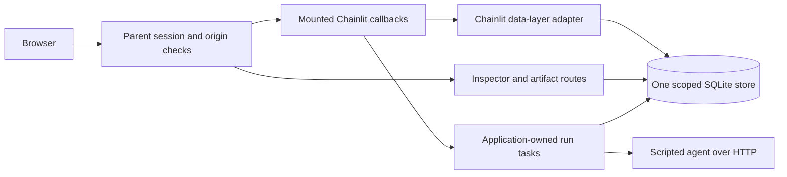
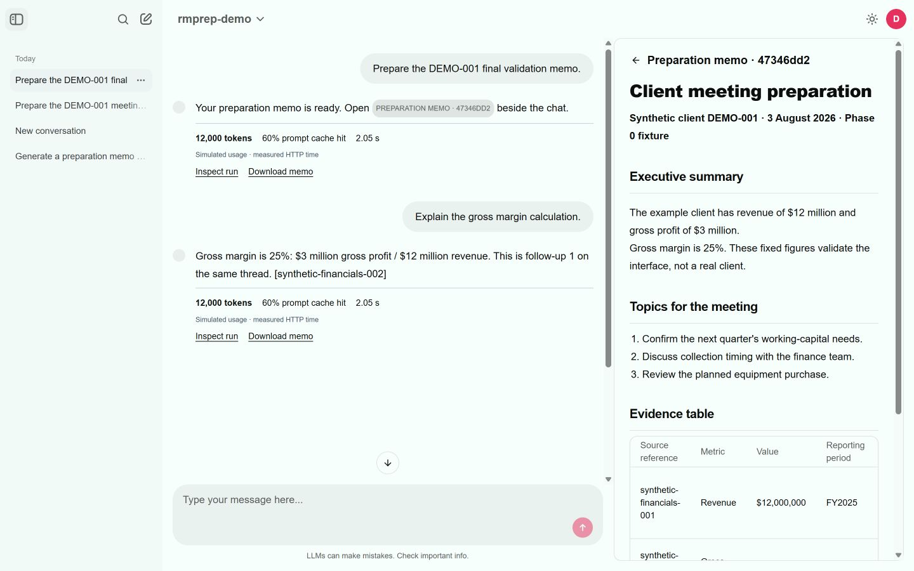
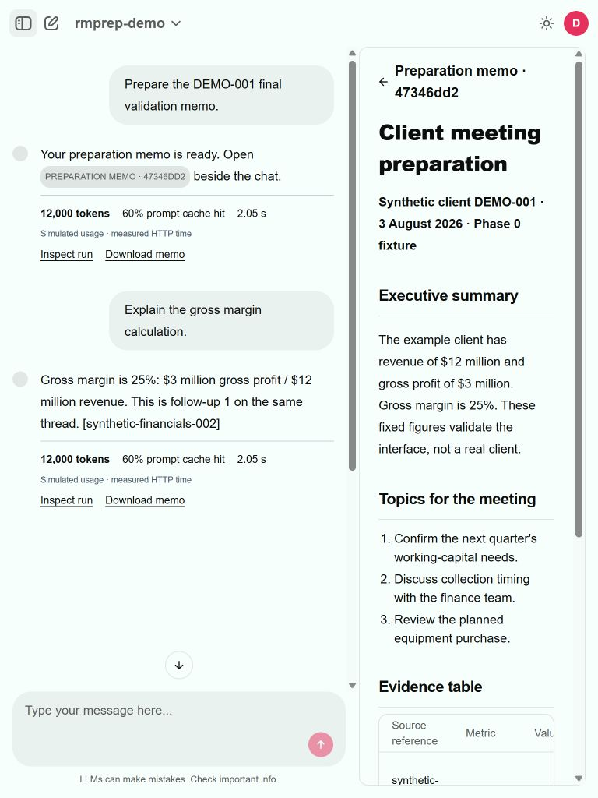
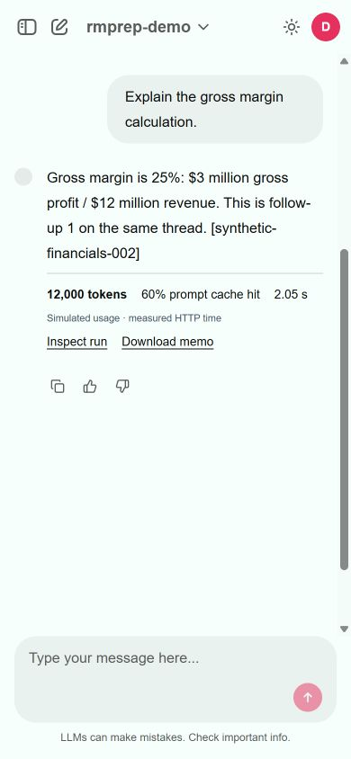
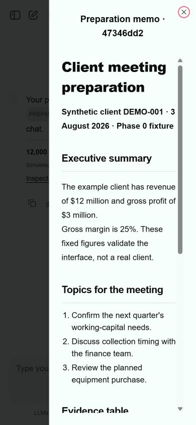
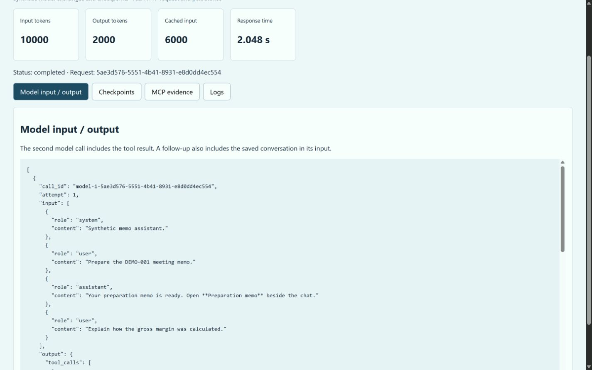
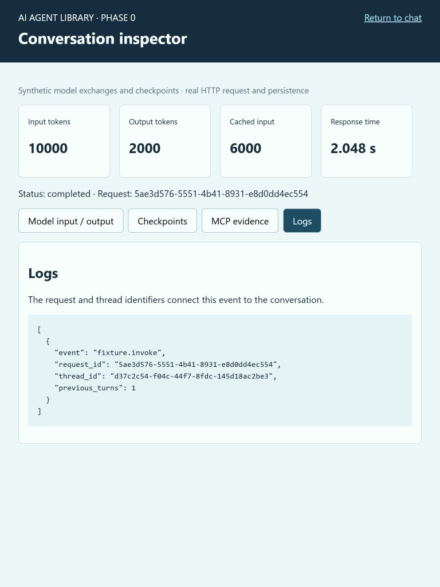
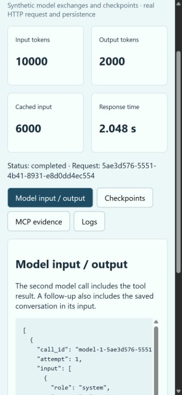

# Frontend Phase 0: Chainlit validation

Reviewed on 11 October 2026 against Chainlit **2.12.0**, Windows x64 and
Python **3.11.15**. The throwaway sample's code has since been removed; its
screenshots and check output are retained as evidence under
`experiments/chainlit-phase0/evidence/`.

## Decision

**Conditional go for Chainlit as the chat shell.** The required chat, history,
memo, metrics, and inspector integration works through supported hooks. The
sample does not modify installed Chainlit code or create a second transcript
database. The production package, `packages/ai-agent-lib-ui`, has since shipped
on this design; this document is kept as the evidence behind that decision, and
the remaining enterprise checks below are tracked separately.

Three findings affect the planned implementation:

1. **Use a separate UI environment.** Chainlit requires `mcp>=1.28.1,<2.0`;
   the library's `core[mcp]` extra requires `mcp>=2.3,<3`. Keep agents and MCP
   servers behind HTTP boundaries. Do not install both extras together.
2. **Prepare approved wheels.** The tested runtime has 126 Python dependencies;
   checks bring the total to 131. Three dependencies needed Python-based wheel
   preparation. The full pinned environment then installed offline using wheels.
3. **Apply an asset policy.** Stock HTML references Google Fonts and a KaTeX
   stylesheet. A parent Content Security Policy blocks external assets. Chat,
   metrics, Markdown memos, and the inspector work with local assets and system
   fonts. The stock references still exist; console messages report their denial.

This is evidence for framework fit, not a production security or accessibility
certification. The broader requirements remain in the
[specification](frontend-specification.md) and [plan](frontend-implementation-plan.md).

## Gate results

| Phase 0 criterion | Result | Evidence and limits |
| --- | --- | --- |
| Command Prompt, Python and pip | Passed on this Windows host | Clean virtual environment, pinned install, and `pip check`. Setup commands are in the sample README. |
| Install entirely from wheels | Passed with prepared wheelhouse | A second clean environment installed with `--no-index --only-binary=:all:` and ran all 24 checks. Actual JFrog availability and enterprise approval are pending. |
| Chat profiles from registry | Passed for a fixture registry | Two agent entries populate Chat Profiles. The registry document also parses with the current library parser. Dynamic registry refresh and production authorization are later work. |
| Authenticated history | Passed | Two questions on one thread, server restart, resumed user/assistant messages and elements. One scoped SQLite store. |
| Memo side panel | Passed | Markdown memo opens beside chat, becomes a drawer at 390 px, and downloads through an authenticated route. Each version has a distinct display name. |
| Response metrics | Passed | Custom element shows 12,000 tokens, 60% cache ratio and measured HTTP time. Usage numbers are explicitly simulated. |
| Full-width inspector | Passed | Model input/output, checkpoints, MCP evidence and logs; authorized JSON/content routes; horizontal and vertical JSON scrolling. |
| Parent HTTP/WebSocket boundary | Passed for exercised paths | Anonymous and forged-header requests denied; wrong-host/origin and mixed parent/chat identities denied; same-tenant and cross-tenant foreign history, element, artifact, inspector, export and socket restore denied. |
| Disconnect, replay and restart | Passed | Admitted task survives a cancelled waiter/browser disconnect. Reusing a run ID invokes the fixture once. Crash after dispatch becomes unknown and is not replayed. |
| Local browser assets | Passed for implemented features | External styles denied by CSP; custom JSX, metrics, memo and inspector still render. Formula rendering and external images are outside this sample. |
| Widths 390, 768 and 1440 | Passed with normal panel controls | Phone uses a memo drawer; collapsing history helps tablet reading. Captured screenshots below. |
| Actual 200% browser zoom | **Pending** | The available browser automation did not apply zoom. Viewport resizing was not counted as zoom validation. Repeat manually in the target enterprise browser. |

## How the boundaries work

Chainlit provides the shell through
[FastAPI mounting](https://docs.chainlit.io/integrations/fastapi),
[custom elements](https://docs.chainlit.io/api-reference/elements/custom),
[history](https://docs.chainlit.io/data-persistence/history), and
[data-layer hooks](https://docs.chainlit.io/data-layers/overview). The experiment
supplies the session boundary, scoped store, run lifecycle, registry translation,
metrics component, and inspector. Installed 2.12.0 interfaces were checked as well
as the documentation; for example, `create_element` receives an element object.

Every message is persisted with a stable ID. The adapter stores a flat transcript,
removing callback-run parent links that otherwise hide answers after resumption.
Admitted tasks save their answers and elements themselves, so a disconnected UI
cannot discard the result. Memo names include a run suffix because Chainlit groups
side elements by name. Selecting a message's uniquely named memo link opens that
document after history is restored. Initial restoration can display multiple
saved side elements together; the supported clear-sidebar hook did not prevent
that restoration behavior in this trial.

The parent session is checked before mounted HTTP/WebSocket traffic. The data
layer checks it again on each operation, including socket events. Caller-supplied
identity headers are stripped. Chainlit's JWT identity must match the parent
identity. Signing out in the chat menu revokes the parent session too.

The three fixture identities encode tenant and subject as `demo/alice`, `demo/bob`,
and `other/alice`. This tests ownership isolation; it does not implement Entra,
OPA permissions, classification policy, or separate debug roles. Phase 1 must
replace the fixture identity with typed authentication and authorization contracts.

## Checks completed

| Check | Result |
| --- | --- |
| Isolated HTTP, WebSocket, lifecycle and store suite | **24 passed** in the clean wheel-installed environment. |
| Existing generated documentation suite | **24 passed**. |
| Ruff check and formatting check for the experiment | Passed. |
| `pip check` in the working and clean install environments | No broken requirements. |
| Registry fixture parsed with current `parse_agents_document` | Both entries accepted. |
| Browser walkthrough | Memo, same-thread follow-up, restored answers, metrics, memo drawer and all inspector tabs inspected. |

The scripted answer is **$3 million / $12 million = 25% gross margin**. The second
turn's model fixture includes the saved first question/answer and then a tool
result. The inspector makes that relationship visible. This does not test an
Anthropic call, a real MCP server, or a LangGraph checkpoint database.

## Dependencies and deployment implications

| Dependency | Tested version | Declared license | Role |
| --- | --- | --- | --- |
| Chainlit | 2.12.0 | Apache-2.0 | Chat, profiles, history hooks, side elements. |
| FastAPI / Starlette | 0.143.0 / 1.7.0 | MIT / BSD-3-Clause | Parent HTTP application. |
| Uvicorn | 0.54.0 | BSD-3-Clause | Local ASGI server. |
| HTTPX | 0.28.1 | BSD-3-Clause | Agent HTTP calls and checks. |
| python-socketio | 5.17.0 | MIT | Chat transport and protocol checks. |
| MCP | 1.30.0 | MIT | Chainlit transitive dependency; built-in MCP UI disabled. |
| Literal AI / Traceloop SDK | 0.1.201 / 0.62.4 | Apache-2.0 | Chainlit transitive dependencies; external tracing not configured. |
| pytest / pytest-asyncio | 9.1.1 / 1.4.0 | MIT / Apache-2.0 | Automated checks. |

The [full Python inventory](../experiments/chainlit-phase0/evidence/dependencies.json)
records versions, runtime/check scope, license declarations and available license
file metadata. The [wheel manifest](../experiments/chainlit-phase0/evidence/wheels.json)
records SHA-256 values for the 131 tested wheel files. The
[runtime lock](../experiments/chainlit-phase0/requirements.lock) and
[check lock](../experiments/chainlit-phase0/requirements-checks.lock) contain the pins.
`record_dependencies.py` regenerates these records from the installed environment.

The configured index did not supply suitable wheels for `literalai==0.1.201`,
`syncer==2.0.3`, and `cuid==0.4`. `pip wheel` built those three without an external
compiler. Platform maintainers should publish approved wheels, including their
build provenance. This trial did not validate the team's JFrog permissions,
package policy, certificates, or software allowlist.

License values are package declarations, not legal approval or a vulnerability
scan. The Python inventory does not enumerate JavaScript dependencies compiled
inside Chainlit's frontend bundle or wheel-build tooling. Obtain and review the
frontend release SBOM/notices and build dependencies before enterprise release.

## Caveats to carry into implementation

- **Content policy:** Chainlit's custom JSX path runs with `unsafe-eval`; the stock
  page also needs inline scripts/styles in this sample. If enterprise CSP forbids
  that, use prebuilt components or choose the planned assistant-ui alternative.
- **Upstream warning:** Chat Profile setup emits an unawaited-coroutine warning
  from Chainlit 2.12.0 `session.py` when it tries to calculate profile overrides
  inside the running event loop. Basic profile selection works; per-profile config
  overrides were not used. Track this when pinning/upgrading the production shell.
- **Expected denial logs:** Revoking a live session produces denied data-layer
  operations during disconnect cleanup. The tests confirm that no new agent
  request is sent. Production should classify these expected denials cleanly.
- **Storage:** The experiment uses bounded synchronous SQLite operations and
  separate short transactions. Production needs atomic result persistence,
  migrations, asynchronous adapters, real pagination and retention controls.
- **Recovery:** Admitted tasks survive browser loss in one process. A process
  crash becomes unknown. Multi-worker ownership, Fargate draining, request outcome
  reconciliation, and load-balancer session affinity remain later-phase work.
- **Feature scope:** Document version selection, deletion, feedback, real trace
  ingestion, role-specific debug access and MCP catalog management are not built.
- **Restored memo selection:** Chainlit can initially combine saved side elements
  in the panel after history restoration. A specific memo link selects one
  correctly. Before Phase 3 acceptance, prove a supported way to restore only the
  selected document, or explicitly adopt a document picker/full-width view.

Close the manual zoom and enterprise dependency/CSP checks before finalizing the
framework gate. If those policies cannot be met through supported extensions,
use React/assistant-ui with the same application layer and Python-served assets.

## Screenshots

These show synthetic data only. Inspector screenshots show the model/checkpoint
fixtures; they are not evidence of live model execution.

| Tablet | Phone chat | Phone memo |
| --- | --- | --- |
|  |  |  |

| Tablet inspector | Phone inspector |
| --- | --- |
|  |  |
