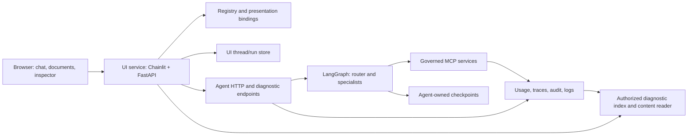

# Agent Lab: frontend specification

Status: staged implementation; updated on 13 October 2026.
The [Phase 1 contracts](frontend-contracts.md) and [Phase 2 local chat package](../packages/ai-agent-lib-ui/README.md)
are implemented in this checkout. Local `init`, `check`, `serve`, registry selection
and SQLite conversation history are available as a development preview. Live
drafts, response metrics and per-response trace links are also implemented.
The temporary draft disappears when the saved outcome is ready. Chat omits
reference and inspector panels; local inspection remains available from Logs. An optional memo panel now supports immutable inline documents and
version selection. Choose agent has explicit Start chat buttons, and Logs provides
the turn-inspection entry point. Shared deployment remains a design proposal.
The package has not been released.
See the [implementation plan](frontend-implementation-plan.md) for delivery order.
The existing [release scope](release-scope.md) remains authoritative for today's library.

## 1. Purpose and recommendation

**Agent Lab** is the application name; `ai-agent-lib-ui` is its separately
installable Python package. It lets people
use registered agents and lets authorized engineers inspect how an answer was
produced. An engineer should be able to install it with Python and pip, start it
from Windows Command Prompt, and open it in their existing browser. Its
[flask logo](../packages/ai-agent-lib-ui/src/ai_agent_lib_ui/assets/agent-lab.svg)
connects three nodes representing an agent, its tools, and saved state. Use the
name and icon on chat, sign-in, and supporting pages, including browser titles
and the favicon.

Use **Chainlit for the chat interface, mounted in a FastAPI application**. Keep
agent invocation, identity, persistence, and diagnostics behind Python interfaces.
Add four small UI features: a registry catalog, response metrics, document version
selection, and a conversation inspector. The inspector has tabs for checkpoints,
model exchanges, MCP calls, and logs. It can occupy the document panel or open as
a full-width page when comparing large records.

The [Phase 0 trial](frontend-phase0-review.md) validates the functional path with
Chainlit 2.12.0 and a scripted HTTP agent. It supports a conditional go: close the
remaining zoom and enterprise dependency/CSP checks before committing to the shell.
The UI needs its own environment because Chainlit's MCP dependency conflicts with
the library's MCP extra. Agent communication remains over HTTP.

### Technology choices

| Component | Recommendation | Reason and boundary |
| --- | --- | --- |
| Chat shell | Chainlit, a tested and pinned release | Reuse messages, chat profiles, conversation history, and side elements. The application still supplies authorization, persistence integration, and agent invocation. |
| Web backend | FastAPI, Pydantic, HTTPX, Uvicorn | One origin for the browser, typed request validation, and asynchronous calls to existing agent services. This backend is often called a backend for frontend, or BFF. |
| Small custom views | Packaged Chainlit custom elements; a packaged inspector page if needed | Build only catalog, metrics, document versions, and diagnostics. Use supported APIs rather than modifying Chainlit internals. |
| Operational storage | SQLAlchemy and migrations; SQLite locally, PostgreSQL in AWS | Persist thread ownership, accepted chat messages, run status, and diagnostic indexes. Keep these tables separate from LangGraph checkpoint tables. |
| Content storage | Private local directory; S3 adapter in AWS | Store document versions and trace/log payloads. PostgreSQL holds searchable metadata and authorized object references. |
| Identity | Server-side Entra sign-in using MSAL Python; configured local identity | Keep sign-in and token acquisition in the BFF. Reuse the library's identity verification and token-exchange contracts at service boundaries. |
| Validation | Pytest, existing contract suites, browser tests in CI | Fake agent/model fixtures keep normal development checks independent of cloud services. Browser tooling runs on an approved runner. |

Chainlit documents [pip installation](https://docs.chainlit.io/get-started/installation),
[agent-like chat profiles](https://docs.chainlit.io/api-reference/chat-profiles),
[history with authentication and persistence](https://docs.chainlit.io/data-persistence/history),
and [Markdown text elements in a side panel](https://docs.chainlit.io/api-reference/elements/text).
It supports [FastAPI mounting](https://docs.chainlit.io/integrations/fastapi),
[custom UI elements](https://docs.chainlit.io/api-reference/elements/custom), and
[custom data layers](https://docs.chainlit.io/data-layers/overview).
These features provide the building blocks; they do not implement this library's
registry, checkpoint authorization, or diagnostic correlation automatically.

### Alternatives and tradeoffs

| Option | What it provides | Fit for this requirement |
| --- | --- | --- |
| Chainlit + FastAPI | An existing Python chat application with history and side elements | Recommended for the smallest initial implementation. Validate customization and deployment constraints first. |
| React + TypeScript + assistant-ui + FastAPI | Chat components and adapters for an application-owned backend and thread store | Preferred fallback for a fully controlled three-panel product. More UI work; CI must build assets and bundle them into the Python wheel so agent developers still install with pip. |
| Gradio | High-level chat and composable UI controls | Suitable for a small demonstration. Our durable thread ownership, agent catalog, document versioning, and inspector still require application design; it offers less advantage for this particular product. |

The alternative assessment is our engineering judgment. See
[assistant-ui's architecture](https://www.assistant-ui.com/docs/architecture),
[its external-store runtime](https://www.assistant-ui.com/docs/runtimes/custom/external-store),
and [Gradio ChatInterface](https://www.gradio.app/docs/gradio/chatinterface)
for the respective integration models. No hosted assistant service is required
by the proposed design.

Chainlit is [community-maintained](https://github.com/Chainlit/chainlit). Assign an
internal dependency owner, pin versions, and test upgrades. Its
[deployment guidance](https://docs.chainlit.io/deploy/overview) calls out WebSockets
and session affinity when scaling. Persistent data alone does not make an active
WebSocket session survive a container restart. If supported hooks cannot meet
our access controls, layout, or reconnect behavior, adopt assistant-ui before
building the remaining screens. Avoid maintaining a Chainlit fork.

## 2. What the repository already provides

This table distinguishes existing capabilities from work the frontend needs.

| Area | Existing implementation | Required addition |
| --- | --- | --- |
| Registry | `RegistrySource` exposes immutable agent and MCP snapshots with IDs, ownership, versions, URLs, tool metadata, and revision IDs. File and S3 adapters exist. | A permission-filtered catalog and a separate presentation manifest for chat bindings, agent audience/scopes, and optional capabilities. PostgreSQL registry support is a separate adapter task. |
| Agent HTTP | `POST /invoke` accepts `input` and `thread_id`; returns `output`, `thread_id`, and `request_id`. | A UI-side transport adapter and explicit mapping between text chat and an agent's input/output shape. |
| Progress | Optional `POST /invoke/stream` emits SSE `update`, `end`, or `error`. Updates are application-defined graph steps. | Safe progress projection and capability detection. Current agents do not provide model-token streaming or resumable event cursors. |
| Conversation state | LangGraph checkpoints are scoped by tenant, subject, application, and thread. Listing requires one authorized thread. | A thread catalog for navigation; opt-in, read-only checkpoint inspection endpoints on the owning agent. |
| Model diagnostics | `agentcraft2.model-trace/v1` records request/response/error, model, call ID, attempt, request, thread, tenant, and subject. Responses retain framework usage metadata. | Authorized indexed queries, content-capture status, and explicit links to graph nodes/checkpoints and accepted or rejected drafts. |
| Audit and logs | Audit records correlate governed operations; HTTP logs include request IDs and durations. | Searchable, bounded read APIs and a merged request timeline. General service logs must be filtered independently of conversation access. |
| Usage | Model audit describes input/output counts; provider usage is recorded even when a later validation rejects a response. | A normalized per-attempt usage event independent of content tracing, including available cache fields and completeness information. |
| Identity | Static local identity, JWT verification, and OAuth/Entra on-behalf-of exchange exist. | Browser sign-in, server sessions, catalog/diagnostic authorization, and acquisition of agent-audience access tokens. |
| Documents | Example agents return answer text; rmprep returns `output.answer`. | An optional, versioned artifact contract. Do not infer a memo from Markdown headings. |

Code references:
[registry](../packages/ai-agent-lib-core/src/ai_agent_lib_core/contracts/registry.py),
[HTTP routes](../packages/ai-agent-lib-core/src/ai_agent_lib_core/integrations/http/agent.py),
[checkpoint scope](../packages/ai-agent-lib-core/src/ai_agent_lib_core/integrations/langgraph/checkpoint.py),
[model tracing](../packages/ai-agent-lib-core/src/ai_agent_lib_core/integrations/langgraph/model_trace.py),
[usage recording](../packages/ai-agent-lib-core/src/ai_agent_lib_core/integrations/langgraph/model.py),
[identity](identity.md), and
[rmprep's service](../examples/rmprep/agents/rmprep/src/rmprep/service.py).

## 3. User experience

### Chat workspace

```text
+-------------------+-------------------------------+-----------------------+
| Threads           | Agent: rmprep       Inspect   | Document / Inspector  |
| Search            |                               | [optional panel]      |
| + New conversation| User question                 |                       |
|                   | Assistant answer              | Memo, version 1       |
| Client meeting    | 12,000 tokens | 60% | 8.2 s   |                       |
| Follow-up review  | [Open memo] [View run]        | or                    |
|                   |                               | Checkpoints / Models  |
| Agent/MCP catalog | Message composer              | MCP calls / Logs      |
+-------------------+-------------------------------+-----------------------+
```

Numbers above are illustrative. The cache value has a tooltip defining it as
the share of input tokens served from the provider's prompt cache.

The thread list supports create, rename, search by title/agent, and archive.
Archive hides a thread from the default list; it does not delete checkpoints or
audit evidence. Each thread belongs to one user and one agent. Selecting another
agent starts a new thread; it never silently transfers saved context. Record the
agent version used on each turn, and show a notice if the deployed version changes.

The composer sends the new question once. The agent restores its own checkpointed
context. The frontend does not resend its entire displayed transcript, which
would duplicate context in a checkpointed graph. The UI remembers drafts locally
only when enterprise policy permits; it never puts conversation content in URLs.

The center shows accepted answers, readable Markdown, source references, document
links, and a metrics footer. Ordinary users see useful progress such as
“Retrieving client records.” Model requests, tool payloads, and rejected drafts
appear only in the authorized inspector. The frontend does not stream arbitrary
graph state directly to the browser.

### Registry catalog

Show searchable agents with description, owner, version, availability, and
supported UI features. Show related MCP servers and registered tools, including
read-only status and classification where policy allows. Registration describes
what exists; authorization decides what this caller can see or use.

Only enabled, authorized agents with a usable HTTP binding can start a chat.
An entry without a URL is shown as “Endpoint not configured” to permitted
developers. A health timeout is “Status unknown,” not proof that an agent is
disabled. Revalidate registry revision and permissions when sending a turn.
Never accept an arbitrary agent URL, import path, or launch command from a browser.

MCP tools are exercised through agents in the first release. A direct tool
playground is a later feature with separate authorization and write-operation
controls; Chainlit's own MCP integration must not create an alternate path around
the library's policy, audit, token exchange, or registry checks.

### Documents

An agent can explicitly return an artifact reference alongside its answer.
Opening it shows a title, version, generation time, originating turn, and rendered
document. The initial supported formats are Markdown and plain text. Downloads
use those formats. A later release can add PDF viewing/export without changing
the basic artifact contract.

Follow-ups stay in the same thread while the document remains visible. A revised
memo creates a new immutable version; answers that explain a data point do not
replace the memo. Where an agent advertises support, “Ask about this section” sends
the selected text plus artifact ID/version as explicit question context. Reading
or downloading an artifact requires the same scope check as its originating turn.

### Conversation inspector

| Tab | What engineers can inspect |
| --- | --- |
| Overview | Turn status, agent version, request ID, elapsed time, usage completeness, and links to related records. |
| Checkpoints | Ordered checkpoints for this thread, timestamps, namespace, parent ID, graph step, next nodes, saved message count, and a bounded state view/diff. |
| Model exchanges | Each call and attempt, role-ordered input messages, tool definitions, invocation options, returned content/tool calls, usage, duration, and errors. |
| MCP calls | Registered server/tool, call ID, input/output when captured and authorized, duration, policy outcome, and related model tool-call ID. |
| Logs | Scoped audit and structured application logs filtered by request, service, event, level, and time; ingestion status and links to related operations. |

“Model input/output” means the serialized exchange at the library's framework
boundary, with credentials masked. It is not an exact provider HTTP capture or a
view of hidden model reasoning. Show the format and source of each record.

The checkpoint view is a conversation debugger, not a SQL console. Inspect
decoded graph state through the owning service and a safe JSON projection.
Do not expose database credentials, arbitrary SQL, unsafe object deserialization,
or checkpoint editing/replay in this release. Expand subgraph namespaces on demand
when the agent supports them; otherwise clearly label the view as root-only.

The key teaching view compares **saved state before a turn**, **the next model
request**, **the MCP result**, and **the following model request**. Use explicit
message/tool-call IDs to show the relationship. Where older traces lack a link,
label it unavailable; matching text or timestamps alone does not prove lineage.
For rmprep, discarded drafts remain visible in diagnostics but not in accepted
conversation history. “Rejected draft” requires an explicit agent event; a model
response alone does not reveal whether the application accepted it.

### Responsive behavior and accessibility

Use the available viewport. On wide screens show three independently scrollable
panes; on smaller screens collapse threads to a drawer and open the document or
inspector as a full-width view with an explicit return-to-chat control. Preserve
the selected thread and unsent text when switching views.

Tables and raw JSON/code panels have both horizontal and vertical scrolling;
ordinary prose wraps. Paginate large histories and fetch payloads only when opened.
Provide visible focus, keyboard navigation, labeled controls, readable contrast,
and announced progress/errors. Verify at 390, 768, and 1440 CSS pixels and 200%
zoom. The exact breakpoints can follow the chosen shell's supported behavior.

## 4. Metrics: precise definitions

Metrics describe the entire user turn, including router/specialist calls, tool
loops, revisions, and observable retries. The answer shown in chat may be only
the last of several model responses. A user can expand the footer to see usage
by model call and attempt.

| Field | Meaning |
| --- | --- |
| Input tokens | Sum of normalized model input tokens, including cache reads/writes exactly once. |
| Output tokens | Sum of provider-reported output tokens, including rejected drafts when usage is available. |
| Total tokens | Input plus output. A token count, not a monetary bill. |
| Prompt cache hit ratio | `sum(cache_read_input_tokens) / sum(input_tokens_total)` across the turn. Display as a percentage only when the required counts are complete and the denominator is positive. |
| Cache writes | Separate input-token count written to cache; a write is not a hit. |
| Response time | BFF elapsed time from accepting the turn to persisting its terminal answer/error. Browser delivery time may be shown separately. |
| Model duration | Per-attempt elapsed time measured at the model boundary. Concurrent call durations are not added to infer wall-clock response time. |
| Usage status | `complete`, `partial`, or `unavailable`, with reported/expected attempt counts where known. Missing data is never represented as zero. |

For example, 6,000 cached-read tokens out of 10,000 total input tokens gives a
60% prompt cache hit ratio. Across multiple calls, sum the numerator and
denominator rather than averaging their percentages. A fully reported zero cache
read is 0%; an absent cache field is “Unavailable.” A complete zero-input turn
shows “Not applicable.” For partial records show known token totals as partial
and leave the overall cache percentage unavailable.

Provider normalization is an adapter responsibility. Anthropic's raw usage
separates uncached input, cache creation, and cache reads; its total input is their
sum. A framework's normalized input count may already include all three, so adding
them again would double count. Preserve source fields and test both formats.
See [Anthropic's usage definitions](https://platform.claude.com/docs/en/build-with-claude/prompt-caching).

Use one canonical usage record per `(scope, request_id, call_id, attempt)`.
Do not add model trace totals to audit totals for the same call. SDK-internal
retries that do not expose usage cannot be reconstructed; show that limitation.
Metrics capture must work when content tracing is off. Existing traces can supply
historical metrics with their available completeness, but are not the permanent
metrics transport. Prompt caching is independent of checkpoint persistence and
HTTP or application response caching. The UI does not enable model caching merely
by displaying its measurements.

An enhanced agent supplies a terminal operation summary so the collector can
check which attempts have arrived. Without that summary, absence of another record
does not prove completeness. Tag simulated or estimated usage explicitly; never
present fixture counts as provider-reported consumption. Missing monotonic timing
in older records may be shown as an estimated duration from timestamps.

## 5. Architecture and ownership



The browser communicates with the UI service only. The UI invokes agents through
their normal authenticated HTTP interface; it does not import their graphs, call
models, or access Redshift. Agents and MCP servers continue to own business rules,
tool authorization, and evidence retrieval. The UI never turns a client-supplied
role or tenant field into an authenticated context.

The new package should have a small application layer with injected collaborators:

| Interface | Responsibility | Initial adapters |
| --- | --- | --- |
| `CatalogReader` | Return authorized agents, MCP metadata, and validated UI bindings | Existing `RegistrySource` plus a presentation manifest and policy checks |
| `AgentClient` | Invoke a selected agent and project supported responses/progress | HTTPX; fake transport for tests |
| `ConversationStore` | Own threads, accepted messages, run status, idempotency records, and event cursors | SQLite; PostgreSQL |
| `CheckpointReader` | Retrieve scoped, decoded checkpoint summaries/state | Agent diagnostic HTTP API; fake reader |
| `DiagnosticReader` | Query authorized usage, model exchanges, MCP calls, and logs | Local indexed JSONL; PostgreSQL index with S3 content |
| `ArtifactStore` | Store and read immutable document versions within scope | Local directory; S3 |

Reuse existing identity, policy, clock, ID, and resource-lifecycle contracts where
they fit. Introduce new interfaces only for independently replaceable behavior.
Domain/application modules must not import Chainlit or LangGraph. HTTP and
Chainlit adapters translate framework types into plain typed values. A composition
root creates and closes adapters. Core and AWS packages must not depend on the UI;
UI-specific AWS storage adapters can live under the UI package's optional extra.

This follows dependency inversion: the conversation service depends on
`AgentClient`, not HTTPX, and tests supply a fake implementing that interface.
The same service can run with SQLite/local files or PostgreSQL/S3 without changing
chat behavior. Keep functions for simple transformations; classes own state or
replaceable behavior, not one class per UI action.

### Persistence and sources of truth

| Data | Owner and rule |
| --- | --- |
| Graph state and execution history | The agent and its LangGraph checkpointer. This is the context used by the next graph invocation. |
| Thread title, owner, agent binding, accepted transcript, run status | The UI store. Chainlit's data-layer adapter reads/writes this store; do not create an independent second chat transcript database. |
| Model and tool diagnostics | Capture pipeline and diagnostic store. Records may include drafts absent from the accepted transcript. |
| Documents | Immutable artifact content plus version metadata; referenced by the accepted turn. |
| Registries | Existing configured registry provider. UI presentation metadata cannot grant access or enable an unregistered service. |

Every stored object and query is scoped by tenant, subject, and agent application,
then thread/request where applicable. Agent checkpoints use the agent's scope,
not the frontend application's name. Entra user identity uses stable tenant/object
IDs consistently across sign-in and service tokens, following the existing preset.
A browser thread ID is a lookup key, never evidence of ownership.

MCP events retain the MCP application's identity. Correlate them to the originating
agent/run through trusted operation metadata and verify access to both resources;
do not relabel their application field or join records by request ID alone.
Unscoped process/startup logs require separate service-log permission and do not
appear in an ordinary conversation view.

Normal navigation lists UI-created threads. Existing non-UI threads can be opened
only by explicit authorized registration of a known thread ID and a supported
history projection. Do not enumerate the entire checkpoint database to populate
the sidebar. Show when a registered historical thread has only checkpoint state
and lacks a complete user-facing transcript.

## 6. Contracts and compatibility

Preserve the current `/invoke` envelope and registry schema. Keep presentation
bindings in a companion versioned document keyed by registered agent ID. Each
binding specifies a supported input/output adapter, required API audience/scopes,
and advertised features: step progress, artifacts, checkpoint inspection, model
tracing, and run status. Validate server-owned destinations and size limits.
Refresh or reject stale bindings when the registry changes.

The initial built-in `question-answer/v1` adapter sends
`{"input": {"question": "..."}, "thread_id": "..."}` and reads `output.answer`,
which fits rmprep and generated question/answer agents. Other input shapes require
an explicit adapter or future schema-driven form. An arbitrary JSON endpoint is
not automatically a chat-compatible agent. Unsupported features appear as
“Not supported by this agent”; ordinary chat still works.

New structured output is opt-in. Retain `answer` for existing clients, and add an
artifact reference collection only for services that advertise it. An artifact
record needs schema version, ID, document ID, version, title, media type, creation
time, originating request/thread, and an authorized content reference or bounded
inline content. Scope comes from the verified request, not model-produced fields.
Only accepted output can publish an artifact; a rejected draft cannot replace it.

For example, this proposed additive output preserves the existing answer field:

```json
{
  "output": {
    "answer": "The preparation memo is ready.",
    "artifacts": [{
      "schema": "agentcraft2.artifact/v1",
      "id": "memo-version-1",
      "document_id": "meeting-memo",
      "version": 1,
      "title": "Client meeting preparation",
      "media_type": "text/markdown",
      "created_at": "2026-08-03T10:00:00Z",
      "request_id": "request-1",
      "thread_id": "thread-1",
      "content": "# Client meeting preparation\n\nMemo content..."
    }]
  },
  "thread_id": "thread-1",
  "request_id": "request-1"
}
```

The BFF validates the metadata against the authenticated invocation, allocates
scoped storage identifiers, stores inline content, and returns its own authorized
artifact URL. Larger content uses a configured content reader and opaque reference;
it is not fetched from arbitrary model-supplied URLs or local file paths.

### Proposed service surface

These routes are new design contracts, not existing endpoints. Chainlit callbacks
and browser routes call the same application services; there must be one turn
execution path regardless of which transport submits the message.

| Boundary | Proposed operations |
| --- | --- |
| Browser to UI | `GET /api/ui/v1/catalog`; list/create/get/rename/archive `/api/ui/v1/threads`; submit `/threads/{id}/turns`; read `/runs/{id}` and `/runs/{id}/events?after=...` |
| Browser to UI inspector | Scoped `/threads/{id}/checkpoints`, `/runs/{id}/models`, `/runs/{id}/tools`, `/runs/{id}/logs`, and artifact metadata/content reads |
| UI to existing agent | `POST /invoke`; optionally `/invoke/stream` with a supported progress projection; existing liveness/readiness routes |
| UI to enhanced agent | Opt-in `/agentcraft2/diagnostics/v1/threads/{id}/checkpoints` and checkpoint detail; `/agentcraft2/diagnostics/v1/requests/{id}` for outcome and checkpoint references |

All list operations use bounded pages and opaque cursors bound to the caller's
scope and filters. Detail APIs distinguish unsupported, disabled, pending,
expired, and unavailable data. Unauthorized object IDs reveal no other user's
existence. Errors expose a stable code and request ID rather than payloads,
database exceptions, or credentials.

Initial query defaults are 50 summaries per page, at most 200; content previews
are limited to 64 KiB and marked when truncated. Larger authorized content is
retrieved separately under a configured byte limit. Cursor and response schemas
must communicate truncation and the next page rather than silently losing records.

The agent owns checkpoint decoding and exposes only a JSON-safe projection through
an explicitly enabled integration. It derives a fresh verified request context,
checks both diagnostic permission and thread ownership, and uses the existing
scoped checkpoint API. The BFF does not read a live checkpoint database directly.

Add structured metadata events for model attempts, tool calls, graph steps,
validation decisions, and checkpoint references where existing records cannot
express the relationship. Carry UI run ID, agent request ID, model call/attempt,
tool-call ID, checkpoint ID/namespace, and parent operation where applicable.
Propagate request correlation to MCP services, while preserving each service's
own operation IDs and authenticated scope. Treat older uncorrelated records as
such. Version new event schemas; preserve current trace/audit readers.

## 7. Execution, failures, and reconnects

Persist a turn and its idempotency key before dispatching it. A repeated browser
submission with the same key and content returns the same run; changed content
with that key is a conflict. Allow one active turn per scoped thread. Enforce this
in the shared store, not just by disabling the send button. Other threads may run
concurrently.

This admission rule covers clients of this UI. If other clients can invoke the
same agent thread, the enhanced agent must also serialize those invocations or
reject a conflict. A UI-only lock cannot coordinate direct API callers. The agent's
request journal and checkpoint changes are not presumed to share a transaction;
an unreconciled crash boundary remains an unknown outcome.

The BFF owns the in-flight task, so a browser disconnect does not automatically
cancel the agent. It persists safe progress and terminal results. Reconnecting
reads the run and resumes delivery after an event cursor; it does not call the
agent again. Deduplicate delivered events and accepted answers.

Use states `accepted`, `running`, `completed`, `failed`, and `unknown` in the first
release. A process failure between agent execution and result persistence can
leave the outcome unknown. Query the enhanced agent's request outcome when
available. Do not automatically retry an ambiguous invocation or release its
thread lock on a timer: a tool may already have executed. Reconciliation or an
explicit operator resolution is required. BFF idempotency does not claim
exactly-once execution across services.

Cancellation is a capability added later. Until agents acknowledge cancellation,
offer “Stop waiting” with an explanation that execution may continue; do not
label it “Cancel run.” Similarly, current step events are progress, not token
deltas. Prefer non-streaming `/invoke` until an adapter can prove which updates
are safe and which output is final. After a streaming error do not silently invoke
the request again.

Failure of diagnostics shows a visible capture/query warning and preserves chat.
It does not relax the library's existing fail-closed authorization or audit rules.
If UI persistence is unavailable before dispatch, refuse a new turn; if it fails
after dispatch, mark/reconcile uncertainty rather than returning a fabricated
success. Show agent startup, timeout, denied access, and expired session distinctly.

## 8. Identity and environments

### Local desktop

Use the enterprise-provided Python, pip configuration, approved package index,
and existing browser. The UI binds to `127.0.0.1` by default. A private SQLite
database and local files provide persistence. Static local identity comes from
configuration, consistent with the agent's tenant/subject/roles. Show a visible
local-mode label. Identity headers/body fields from the browser cannot override
it. Local identity mode must refuse remote binding or remote service destinations.

The proposed consumer workflow is:

```bat
rem Proposed commands, available after ai-agent-lib-ui is released
python -m venv .venv
.venv\Scripts\python.exe -m pip install ai-agent-lib-ui
.venv\Scripts\python.exe -m ai_agent_lib_ui init
.venv\Scripts\python.exe -m ai_agent_lib_ui check
.venv\Scripts\python.exe -m ai_agent_lib_ui serve
```

`init` creates a commented configuration with registry and agent-binding paths.
The developer fills in those paths, starts the agent/MCP services using their
existing commands, then runs `check` and `serve`. `check` validates configuration,
approved endpoint bindings, persistence, and advertised capabilities; it makes no
model/tool calls. The command prints the browser URL and actionable setup errors.

Ship browser assets in the wheel. Desktop users need neither a JavaScript build
step nor administrator access. UI maintainers may use an approved JavaScript
toolchain in CI for custom assets and browser tests. Test wheel availability for
the enterprise's supported Python/Windows combination; pin and mirror dependencies
through its existing package process. Keep proxy and CA configuration explicit.

### AWS and Entra

Run the UI/BFF as a separate Fargate service behind HTTPS and a WebSocket-capable
load balancer. Agents, MCP servers, and OPA retain their separate services. Use
managed PostgreSQL for UI metadata, checkpoint stores, and operational mappings
in separately owned schemas. S3 holds durable documents, traces, and log payloads.
Redshift remains behind governed MCP business queries.

The BFF owns Entra authorization-code sign-in and server-side sessions. Use a
maintained authentication library, state/nonce and applicable PKCE validation,
secure HttpOnly cookies, same-origin requests, and CSRF/Origin checks for HTTP and
WebSocket mutations. The Chainlit identity bridge accepts only identities produced
by this authentication boundary; external headers with those names are stripped.
Do not expose tokens in Chainlit thread metadata, browser storage, or debug output.
Use [MSAL's documented token acquisition flows](https://learn.microsoft.com/en-us/entra/msal/python/getting-started/acquiring-tokens)
and a protected, user-partitioned server token cache; browser sign-in integration
and the session store still require application implementation.

Acquire an access token for the selected agent API with configured delegated
permissions. An Entra ID token or Graph access token is not an agent credential.
The agent continues its existing on-behalf-of exchange for MCP audiences. If the
BFF itself receives an API access token, its downstream delegation can use OBO;
do not attempt OBO with a session cookie or ID token. Application registrations,
consent, token refresh, and role mappings must be validated in the enterprise tenant.
See [Microsoft's OBO requirements](https://learn.microsoft.com/en-us/entra/identity-platform/v2-oauth2-on-behalf-of-flow).

Read-only chat access and diagnostic content access are separate permissions.
Default diagnostic access is to the caller's own threads. Cross-user support access
is outside the initial release. Define policy actions for catalog visibility,
agent invocation, artifact reading, diagnostic metadata, and diagnostic content.
Reauthorize at each read, download, reconnect, and invocation; hiding a tab is not
authorization. Never trust client-provided roles or use the UI service account as
the user identity for agent calls.

Raw content tracing is explicitly enabled at the agent/MCP capture boundary with
configured retention. The UI cannot enable it globally by opening the inspector.
Credential masking is not business-data anonymization. Restrict and audit content
reads; keep raw diagnostic payloads out of ordinary chat persistence and telemetry.
Render model/tool/registry content as untrusted data: sanitize Markdown, disable
raw HTML/script execution and remote embeds, validate link schemes, and authorize
downloads. Apply payload size and query limits at both API and renderer boundaries.

### Storage and configuration rules

| Concern | Local | AWS | Design rule |
| --- | --- | --- | --- |
| Catalog source | Existing registry files | Existing S3 registry; PostgreSQL adapter when implemented | Reuse `RegistrySource`; do not claim the database adapter already exists. |
| Threads, sessions, runs, indexes | SQLite/private local files | PostgreSQL | Separate ownership, migrations, least-privilege credentials, and bounded queries. |
| Checkpoints | Agent-owned SQLite | Agent-owned PostgreSQL | Read through agent diagnostics; never through browser SQL. |
| Documents and diagnostic content | Private configured directory | S3 | Immutable content references with scope, retention, encryption, and read authorization. |
| Logs | Structured files/stdout | Collected structured logs, archived to S3 | An index locates authorized request records; S3 is object storage, not a mounted filesystem. |
| Sign-in | Server-configured local principal | Entra server session and agent access tokens | Keep subject/tenant consistent with checkpoint scope. |

Incrementally index local JSONL using file identity/offsets, handling incomplete
lines and rotation. In AWS, ship bounded immutable batches and ingest their
metadata into PostgreSQL with idempotent record IDs. Track ingestion watermarks;
“not arrived” differs from “no calls.” Never scan all S3 objects on each UI request.
Start with request/time/event lookup; a dedicated search service is optional later.

Use separate typed UI configuration with a reserved `AGENTCRAFT2_UI_` prefix; do not
pass new names to core's strict `AC2_` parser. The implementation must publish one
generated variable table with name, purpose, local/AWS examples, defaults, and
sensitivity. Settings cover bind address, registry/bindings, identity/session,
stores, diagnostics permissions/capture visibility, limits, and retention.
Secrets are references to the configured secrets provider, not literal registry
or presentation fields. Session/capture retention and deletion policy are deployment
inputs. Archiving a thread does not override them.

## 9. Release boundary and acceptance

The first usable local release includes agent selection, persistent threads,
same-thread chat, document viewing, response metrics, and the read-only inspector.
The AWS release additionally requires Entra, PostgreSQL/S3, shared concurrency
controls, and tested WebSocket reconnect/container-replacement behavior. A local
prototype is not sufficient evidence for the AWS release.

| Acceptance scenario | Required result |
| --- | --- |
| Restricted Windows desktop | Install the published wheel from the approved index and run from Command Prompt using Python/pip and an existing browser. |
| rmprep memo and follow-up | Produce a memo for JONE-0022 as of 2026-08-03, then ask a follow-up on the same thread; graph state supplies saved context. Fake fixtures run in CI; live Anthropic is an explicitly selected verification. |
| Restart and ownership | UI restart restores thread titles/transcript; agent restart restores checkpoints. Another subject/tenant cannot list, read, or invoke that thread. |
| Document history | Open a memo, ask about it, produce version 2, and reopen version 1 without losing the current chat. |
| Evidence inspection | Follow a model tool-call ID to its MCP result and the next model input; compare the preceding and following checkpoints. Missing lineage is labeled. |
| Rejected draft | A model response rejected by rmprep is visible only in permitted diagnostics; its tokens still contribute to turn usage. |
| Metrics | Fixtures verify cache reads/writes, normalized/raw formats, multiple attempts, unknown fields, zero input, and concurrent calls without double counting. |
| Trace disabled or late | Chat and metrics work; inspector clearly distinguishes disabled capture, delayed ingestion, and unavailable content. |
| Duplicate send/disconnect | Double submission executes once within the BFF admission boundary; reconnect displays existing progress/result. Ambiguous cross-service outcomes are not retried. |
| Access revocation | Reconnects, downloads, catalog reads, and raw-content endpoints recheck authorization; a previously open tab grants no continuing access. |
| Rendering and limits | Long memo/table/JSON content remains usable at target widths; unsafe markup is inert and oversized payloads are bounded. |
| Compatibility | Existing agents and clients pass current contracts unchanged. Unsupported document/debug features do not break ordinary chat. |

Deferred features: checkpoint mutation/replay, conversation branching, direct MCP
tool execution, arbitrary file upload, document editing, token-level streaming,
acknowledged cancellation, cross-user support access, model-cost billing, and
unattended durable workflow execution. These can build on the same contracts once
their semantics are defined. A small feedback action and an authorized redacted
run export are useful follow-ups after the core workflow is reliable.
